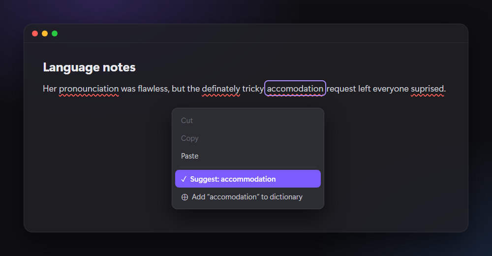

# Offline Spell Checker for Obsidian

Private, instant spell checking with built-in dictionary downloads and guarded fuzzy search. Nothing leaves your vault.

## Features

- **Fully offline.** Hunspell `.dic` / `.aff` dictionaries, checked as you type.
- **Built-in downloader.** 45+ languages (English US/UK/CA/AU/IN, Medical, Hindi, Spanish, French, German and more) installed in one click from settings.
- **Right-click fixes.** Suggestions from dictionaries and, optionally, your note titles.
- **Personal dictionary.** Names, acronyms and terms that should never be flagged.
- **Guarded fuzzy search.** Typo-tolerant lookup across notes, dictionary and vocabulary.

## Install

1. Copy `main.js`, `manifest.json` and `styles.css` to `<vault>/.obsidian/plugins/sxjeel-spell-checker/`.
2. Enable **Offline Spell Checker** in Community plugins.
3. Open its settings and install a dictionary, e.g. **English (US)**.

## Settings

| Setting | What it does |
| --- | --- |
| Enable Spell Checker | Underline misspelled words as you type |
| Fuzzy Matching Sensitivity | `Off`, `Normal` (default) or `Loose` typo tolerance |
| Suggest note titles | Include vault note titles in suggestions |
| Accept prefix compounds | Treat words like `subsystem` or `multimodal` as correct |
| Dictionaries | Quick install, 45+ language catalog, installed list with delete |
| Personal dictionary | Add and manage custom words (`personal.txt`) |

## Commands

- **Guarded Fuzzy Search** (notes, dictionary and vocabulary)
- **Toggle Spell Checker On/Off**
- **Download Default English (US) Library**

## Guarded fuzzy matching

Word order doesn't matter, and every query word must match.

| Word length | Typos allowed |
| --- | --- |
| 1–4 | none (exact or prefix) |
| 5–9 | 1 |
| 10+ | 2 |

- Prefixes count: `constit` finds `Constitution`.
- Dropped spaces work: `polityrevision` finds `Polity Revision`.
- Transpositions are caught: `troubelshoot` finds `Troubleshooting`.
- Scattered letters never match: `writing` will not find `Airbyte Checkpointing`.
- No cross-word borrowing: `invoice` will not find `Brand Voice` (relaxed in `Loose`).

## License

MIT
